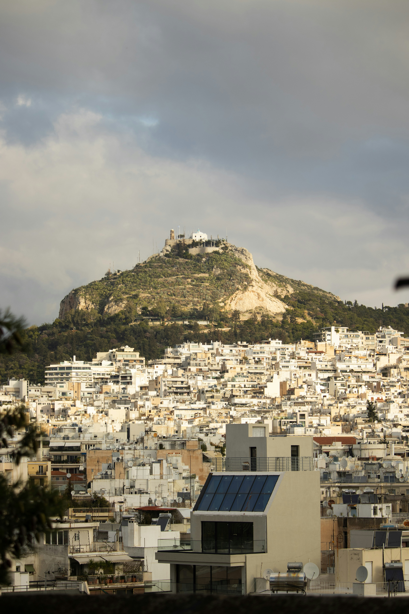
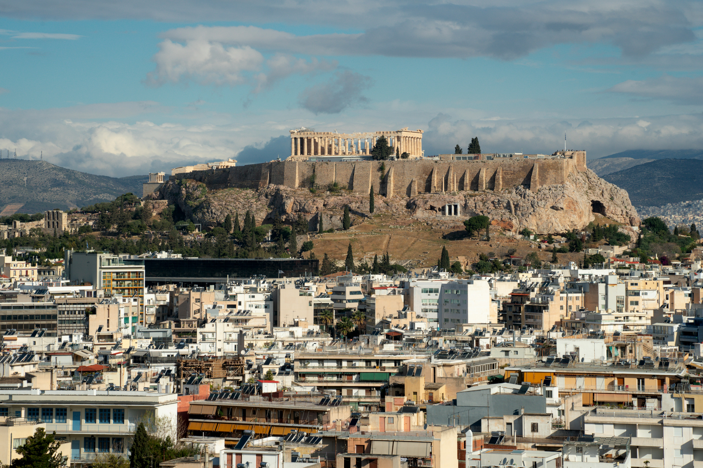

# My Favorite City: Athens

**Athens** is the capital of Greece and one of the oldest cities in the world, with a history stretching as far back as **3,000 years**. I like it because it mixes *ancient history with modern culture*. 

It is also the birthplace of democracy and the centre of theatre.

## Why I Love Athens
1. The main reason I love Athens is the ancient history it carries. I have always loved learning about the ancient history of several world countries, cities and civilisation. For example, the wars that took place with Sparta regularly, the ancient thinkers and writers that came out of them, the first place to host the modern Olympics in 1896, etc [Wikipedia](https://en.wikipedia.org/wiki/Athens)
2. I love Greek mythology; Their gods, stories and beliefs have always been interesting and fun to read about. Give me any movie on Greek mythology and I'm good to go.
3. I love ancient architecture. The temple of goddess Athena, Dionysus and Zeus, the Parthenon, etc. They look too grand in videos and pictures. I would love to see them first hand.
4. Greece is known to have sunny and warm weather. Any weather that allows me to enjoy outdoor activities is always welcome.

## Where I Would Love to Visit
- The Acropolis and The Parthenon: [This is Athens](https://www.thisisathens.org/)
- The Acropolis Museum 
- Monastiraki & Psirri: [Visit Greece](https://greektraveltellers.com/blog/monastiraki-complete-guide-and-things-to-do)
- The Temple of Zeus

---

*Written by FABUNMI AANUOLUWA LYDIA*

